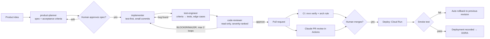

# How work flows from idea to production

## Where quality comes from

Agents make code cheap, so review and verification become the bottleneck. Every layer below exists because a
coding agent can produce code that looks right and isn't.

| Layer | Mechanism | Catches |
|---|---|---|
| Context | `CLAUDE.md`, role prompts | wrong architecture, missing idempotency, style drift |
| Planning gate | spec + human approval before code | building the wrong thing (the most expensive bug) |
| Fast feedback | compile hook after each edit, test hook before "done" | broken builds, hallucinated APIs |
| Tests | acceptance criteria → tests, edge-case hunting | regressions, unhappy paths |
| Independent review | read-only reviewer on a separate context (and a different model) | plausible-but-wrong logic, races, security |
| Hard guardrails | permissions + PreToolUse hooks | force-push, deploys, IAM, secret access |
| Pipeline | CI, AI PR review, human merge, smoke test + rollback | anything that slipped through, quickly reverted |
| Measurement | DORA (`scripts/dora.sh`) | "faster typing" that doesn't become faster, safer delivery |

## Why subagents and not one big prompt

- **Context isolation:** the reviewer doesn't inherit the implementer's reasoning, so it doesn't share its blind spots.
- **Least privilege:** the reviewer can't edit, the test engineer only touches `src/test`, and nobody deploys.
- **Cost/latency:** planning and review run on the strongest model, while implementation and tests run on a faster one.
- **Repeatability:** the same roles run locally (`/feature`) and in CI (`claude-review.yml`, `claude.yml`).

## When I don't use the pipeline

For a one-line fix, a config change or an exploratory spike, I work directly with Claude Code in plan mode. The
full pipeline is worth it when the change has business rules, concurrency, or a public contract.
